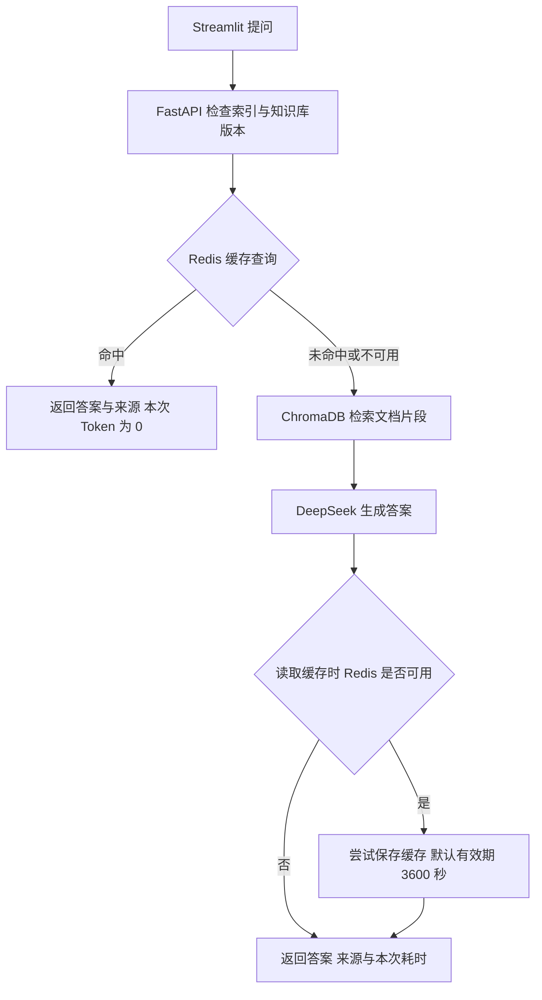

# AI 智能知识库问答系统

上传自己的资料，再像聊天一样提问。系统会先从文档里找到相关内容，再交给大模型组织答案，并展示参考文件，方便核对。

这是一个面向 AI 应用开发的个人实践项目，把文档处理、检索、模型调用、Redis 缓存和 Docker 部署串成一个能实际使用的应用。

## 能做什么

- 上传 PDF、TXT、Markdown 文件，自动解析、切分并建立向量索引。
- 用自然语言提问，回答附带参考文件来源。
- 查看、删除知识库文件，删除后更新索引。
- 通过提示词约束模型：资料里没有答案时，说明未找到相关信息。
- 相同问题在知识库和生成设置不变时复用缓存，保留答案与来源，减少重复调用模型。
- 页面展示缓存状态、本次与原始生成 Token、后端处理耗时；提供缓存统计接口。

## 怎么实现

**技术栈：** Python、FastAPI、Streamlit、LangChain、ChromaDB、Hugging Face Embedding、PyMuPDF、DeepSeek API、Redis / redis-py、Docker Compose。



- **检索与生成分开处理**：使用 `BAAI/bge-small-zh-v1.5` 在 CPU 上计算文本向量，ChromaDB 保存和检索向量，DeepSeek 负责回答。
- **前后端分开部署**：Streamlit 提供页面，FastAPI 处理上传和问答，容器之间通过服务名通信。
- **数据不绑在容器里**：文档、向量库文件和模型缓存使用命名数据卷保存；API Key 通过环境变量传入，不写进镜像。
- **缓存随文档变化**：Key 包含原始问题、知识库内容版本、模型、temperature、检索数量和问答规则版本。文档名与内容指纹生成知识库版本，上传或删除后不会继续取用旧版本答案；旧缓存等待 TTL 自动过期。
- **Redis 不是必需的数据来源**：未命中走原有 RAG；Redis 不可用时绕过缓存，保存失败也不丢弃已生成答案。缓存关闭自动持久化，Redis 重启后可以重新生成。

## Docker 运行

需要先启动 Docker，并准备可用的 DeepSeek API Key。以下命令以 **Git Bash** 为例。

### 1. 获取代码并配置 Key

```bash
git clone https://github.com/PeterG666/project1-rag-go.git
cd project1-rag-go
cp -n .env.example .env
```

用编辑器打开 `.env`，填写自己的 Key，不要提交真实 Key：

```dotenv
DEEPSEEK_API_KEY=your_deepseek_api_key
```

### 2. 构建两个镜像

当前 Compose 引用本地镜像，需要先完成构建。下面只打包必要文件（也适用于本地中文项目目录）：

```bash
tar -cf - .dockerignore Dockerfile.backend requirements.txt main.py cache_service.py | docker build -t rag-backend:v1 -f Dockerfile.backend -
tar -cf - .dockerignore Dockerfile.frontend requirements.frontend.txt app.py | docker build -t rag-frontend:v1 -f Dockerfile.frontend -
```

### 3. 启动服务

两个镜像都构建成功后，启动 Redis 和后端并查看日志：

```bash
docker compose config --quiet
docker compose up -d redis
docker compose up -d --no-build backend
docker compose logs -f --tail 40 backend
```

首次启动需要联网下载 Embedding 模型，之后会保留缓存。看到 `Application startup complete` 后，按 `Ctrl+C` 退出日志跟踪，再启动前端：

```bash
docker compose up -d --no-build frontend
```

- 页面：[http://localhost:18512](http://localhost:18512)
- 接口文档：[http://localhost:18012/docs](http://localhost:18012/docs)
- 缓存统计：[http://localhost:18012/cache/stats](http://localhost:18012/cache/stats)

在页面上传一份资料，等待索引建立完成，就可以提问。未命中或绕过缓存的问答会调用自己的 DeepSeek API 额度。Redis 不映射宿主机端口，后端通过 Compose 服务名 `redis:6379` 访问它。

## 验证与说明

已完成本地手工验证：文档上传与删除、带来源问答、首次未命中与重复命中、TTL 过期重新生成、同名文档修改及删除后的缓存失效、Redis 停止时正常问答、后端和 Redis 分别重启，以及 Streamlit 前后端通信。

一组本地手工测试记录如下（仅代表该次运行，不是固定的性能数据）：

| 指标 | 未命中 | 紧接着的缓存命中 |
| --- | ---: | ---: |
| 后端处理耗时 | 2544.44 ms | 0.61 ms |
| 本次 Token | 662 | 0 |
| 本组新增应用模型调用 | 1 | 0 |

`/cache/stats` 记录 hit、miss、bypass 和应用模型调用次数；后端重启后归零。调用次数指程序进入 SDK 调用的次数（不是服务商计费明细或 SDK 内部重试次数）。

重启后，首次提问会根据保留的文档重建索引。文档、向量库和模型缓存保存在 Docker 数据卷中，不随 GitHub 代码上传；使用 `docker compose down -v` 会删除这些卷。

目前适合个人本地使用和项目演示：只做精确问题缓存。当前使用单后端进程，共用线程锁保护问答和文档更新；模型生成时其他受保护操作会等待。每次提问会读取文件计算知识库版本。

后期可优化空间：加入登录、用户隔离、语义缓存和自动化评测；针对大规模文档或多实例并发优化。
